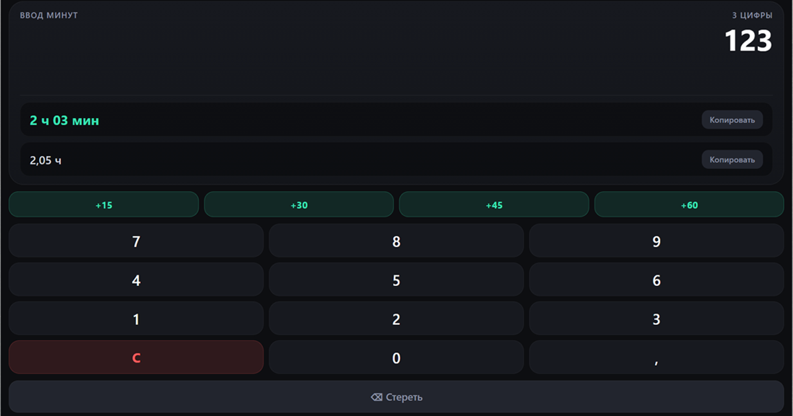

<div align="center">


# min2hour

**Быстрый и минималистичный онлайн-калькулятор перевода минут в часы и десятичные доли**

[](https://cte17a.github.io/min2hour/)

<br>
</div>

## ✨ Возможности

* **Два формата вывода одновременно:** привычный вид (`1 ч 30 мин`) и десятичный формат (`1,5 ч`).
* **Копирование в один клик:** отдельные кнопки для быстрого переноса нужного значения в буфер обмена.
* **Быстрые пресеты:** кнопки `+15`, `+30`, `+45` и `+60` минут для удобного суммирования отрезков времени.
* **Адаптивный интерфейс:** крупная экранная клавиатура.



## 🚀 Локальный запуск

Проект не требует сборки или установки зависимостей:

1. Склонируйте репозиторий:
   ```bash
   git clone [https://github.com](https://github.com/CTE17A/min2hour.git)
   ```
2. Откройте файл `index.html` в браузере.
